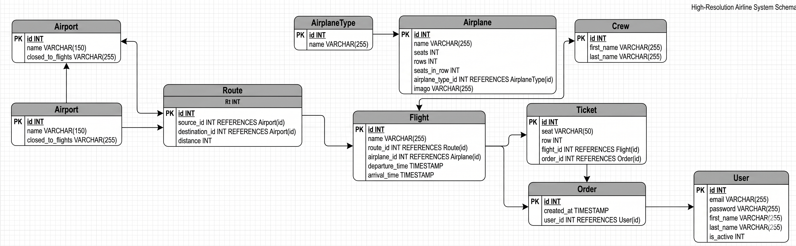

# Airport API

Airport API is a RESTful backend application for managing airports, routes, airplanes, flights, tickets, and orders.
The project is built with Django REST Framework and includes JWT authentication, Swagger documentation, Docker support, PostgreSQL database integration, filtering, pagination, and airplane image upload.

## Database Schema


## Features

* User registration and JWT authentication
* Airport, route, airplane, airplane type, crew, flight, ticket, and order management
* Flight filtering by source airport, destination airport, airplane, and departure date
* Airplane filtering by name and airplane type
* Ticket booking system with seat validation
* Prevention of duplicate tickets for the same flight seat
* User-specific order history
* Airplane image upload
* Swagger and Redoc API documentation
* Docker and Docker Compose support
* PostgreSQL database
* Test coverage for main API flows

## Technologies

* Python 3.12
* Django
* Django REST Framework
* PostgreSQL
* Docker
* Docker Compose
* Simple JWT
* drf-spectacular
* Pillow

## Installation

Clone the repository:

```bash
git clone https://github.com/7/py-airport-api.git
cd py-airport-api
```

Create environment file:

```bash
cp .env.sample .env
```

Create and activate a virtual environment:

```bash
python -m venv venv
source venv/bin/activate
```

On Windows:

```bash
venv\Scripts\activate
```

Install dependencies:

```bash
pip install -r requirements.txt
```

## Run with Docker

Build the Docker image:

```bash
docker compose build
```

Start the application:

```bash
docker compose up
```

Or run it in the background:

```bash
docker compose up -d
```

The API will be available at:

```text
http://localhost:8000/
```

## Database setup

Run migrations inside the Docker container:

```bash
docker compose exec airport-app python manage.py migrate
```

Create a superuser:

```bash
docker compose exec airport-app python manage.py createsuperuser
```

Load sample data from fixtures:

```bash
docker compose exec airport-app python manage.py loaddata fixtures/sample_airport_fixture.json
```

## API Documentation

Swagger documentation:

```text
http://localhost:8000/api/schema/swagger-ui/
```

Redoc documentation:

```text
http://localhost:8000/api/schema/redoc/
```

OpenAPI schema:

```text
http://localhost:8000/api/schema/
```

## Authentication

The API uses JWT authentication.

Create a user:

```text
POST /api/v1/user/register/
```

Request body:

```json
{
  "email": "user@example.com",
  "password": "your_password"
}
```

Get JWT token:

```text
POST /api/token/
```

Request body:

```json
{
  "email": "user@example.com",
  "password": "your_password"
}
```

Response:

```json
{
  "refresh": "your_refresh_token",
  "access": "your_access_token"
}
```

Use the access token in requests:

```text
Authorization: Bearer your_access_token
```

Refresh token:

```text
POST /api/token/refresh/
```

Request body:

```json
{
  "refresh": "your_refresh_token"
}
```

## Main API Endpoints

```text
/api/v1/airports/
/api/v1/routes/
/api/v1/crew/
/api/v1/airplane-types/
/api/v1/airplanes/
/api/v1/flights/
/api/v1/orders/
/api/v1/tickets/
/api/v1/user/register/
/api/token/
/api/token/refresh/
```

## Filtering

Filter airplanes by name:

```text
GET /api/v1/airplanes/?name=Boeing
```

Filter airplanes by airplane type:

```text
GET /api/v1/airplanes/?airplane_type=Passenger
```

Filter flights by source airport ID:

```text
GET /api/v1/flights/?source=1
```

Filter flights by destination airport ID:

```text
GET /api/v1/flights/?destination=2
```

Filter flights by airplane ID:

```text
GET /api/v1/flights/?airplane=1
```

Filter flights by departure date:

```text
GET /api/v1/flights/?date=2025-09-25
```

Filters can be combined:

```text
GET /api/v1/flights/?source=1&destination=2&airplane=1&date=2025-09-25
```

## Airplane Image Upload

Upload an image for a specific airplane:

```text
POST /api/v1/airplanes/{id}/upload-image/
```

Request type:

```text
multipart/form-data
```

Request body:

```text
image: selected image file
```

Example response:

```json
{
  "id": 1,
  "image": "http://localhost:8000/media/airplane-image.png"
}
```

## Running Tests

Run tests inside Docker:

```bash
docker compose exec airport-app python manage.py test
```

Or locally:

```bash
python manage.py test
```

## Stopping Docker

Stop containers:

```bash
docker compose down
```

Stop containers and remove volumes:

```bash
docker compose down -v
```

Warning: removing volumes deletes PostgreSQL and media data stored by Docker.

## Project Structure

```text
py-airport-api/
├── airport/
├── airport_service/
├── user/
├── fixtures/
├── media/
├── Dockerfile
├── docker-compose.yml
├── requirements.txt
├── manage.py
└── README.md
```
